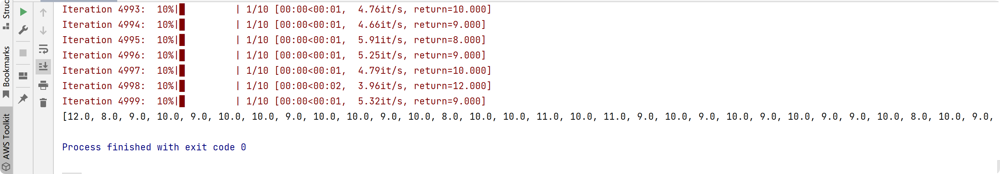
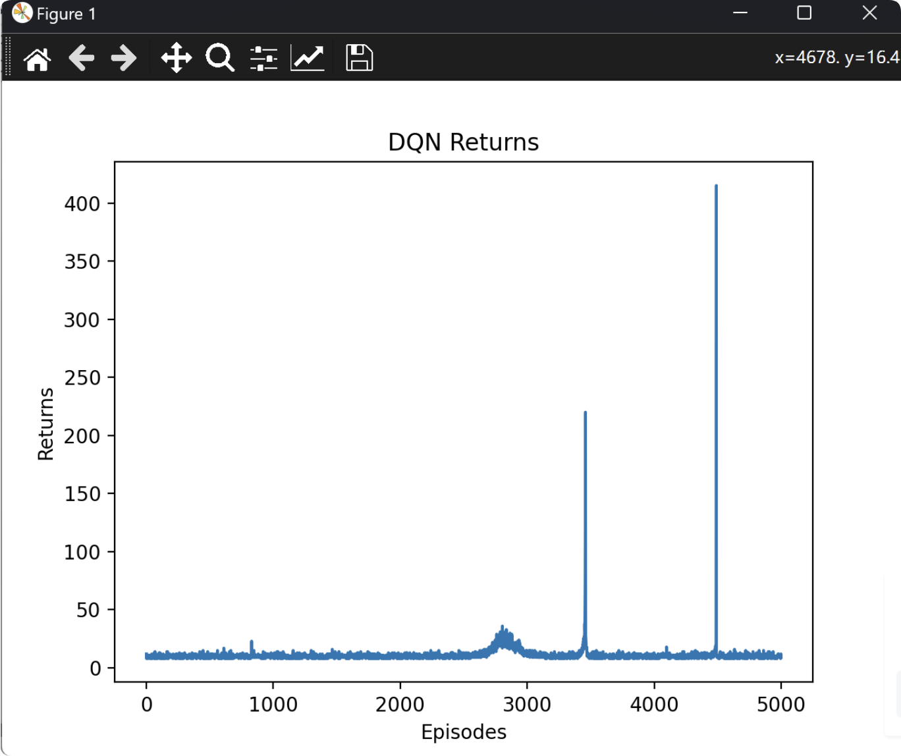

# [PyTorch] [A DQN agent for UAV] Research on drone control based on deep Q-network (Python code implementation)

[PyTorch][A DQN agent for UAV]Research on UAV Control Based on Deep Q-Network (Python code implementation)
\n        \n  
\n        \n  

## Images

<!-- PAYMENT_BLOCK -->

## Get this dataset

- Payment link (Stripe): [Buy now](https://buy.stripe.com/3cs8yP7sY87d0vu9AB)
- Payment QR code: 

<!-- /PAYMENT_BLOCK -->
